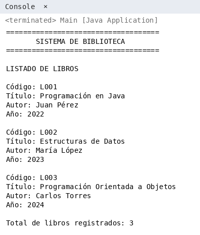
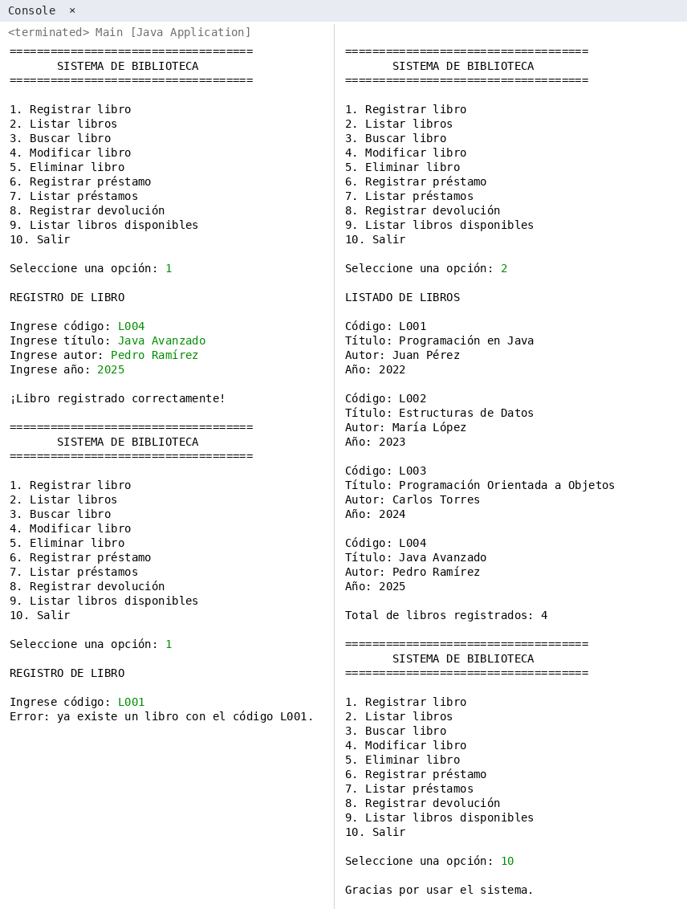
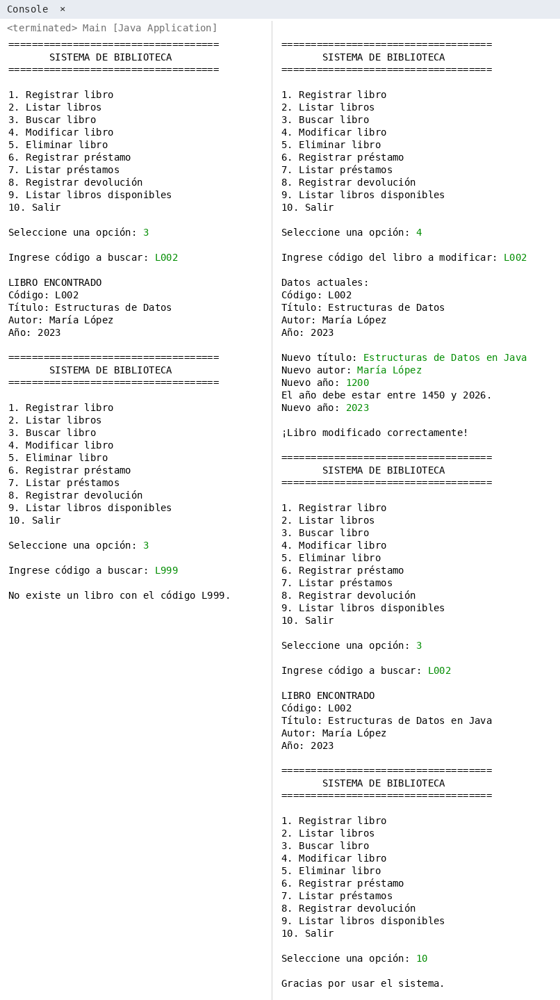
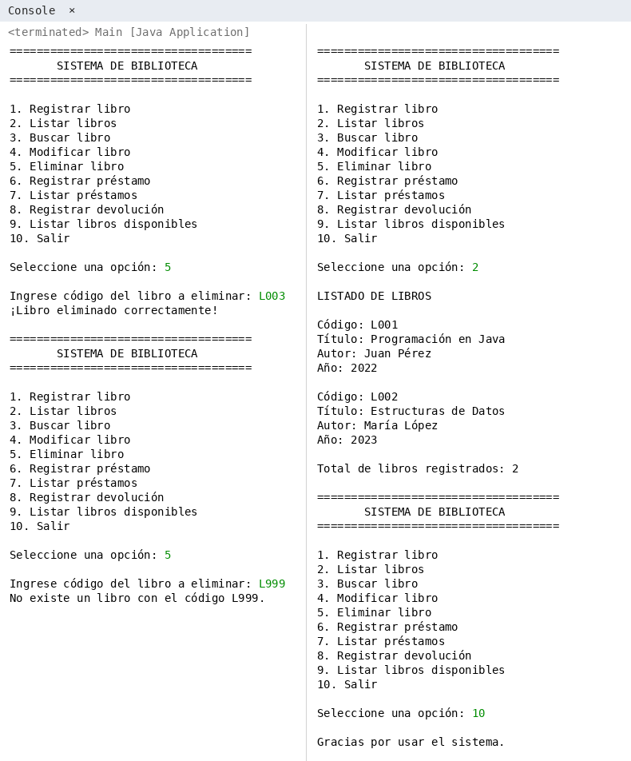
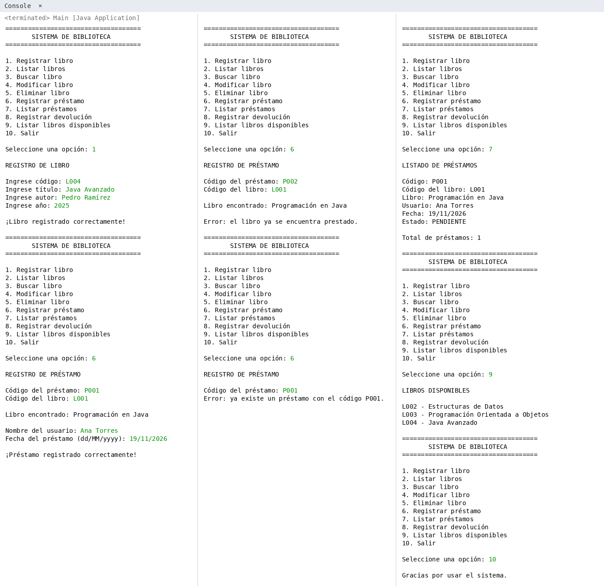
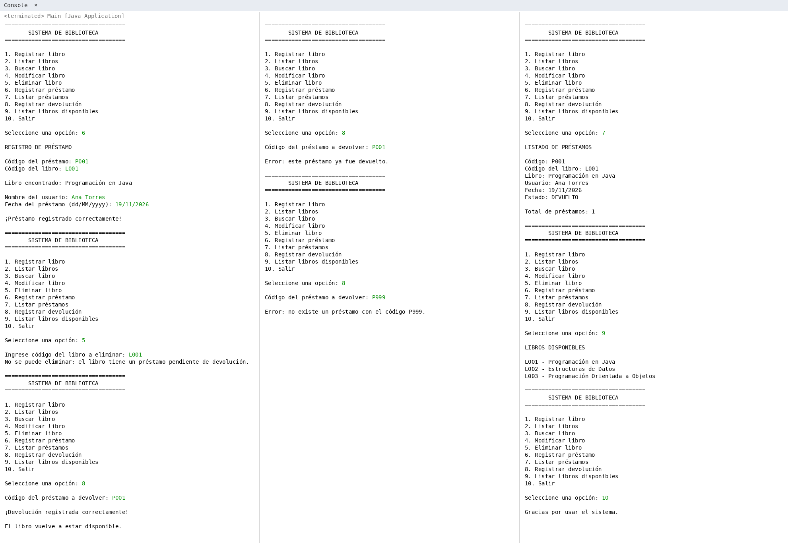

# Laboratorio 08: Gestión de colecciones de objetos con JavaBeans y ArrayList

Curso: Lenguaje de Programación I

Alumno: José Luis Hancco Valencia

Tema integrador: Sistema de gestión de una biblioteca

## Descripción del problema

Una biblioteca lleva el registro de sus libros y de sus préstamos de forma manual. En este laboratorio se construye una aplicación de consola en Java que permite registrar los libros, administrarlos (buscar, modificar y eliminar) y controlar los préstamos y devoluciones, de modo que en todo momento se sepa qué libros están disponibles.

La aplicación se desarrolló de forma progresiva en un solo proyecto de Eclipse, en tres ejercicios (básico, intermedio y avanzado), y cada avance quedó registrado en un commit.

## Objetivos

- Crear y configurar un proyecto Java en Eclipse IDE.
- Diseñar clases JavaBean aplicando encapsulamiento (atributos privados, constructores, getters y setters).
- Almacenar y administrar colecciones de objetos con `ArrayList`.
- Implementar operaciones para agregar, listar, buscar, modificar y eliminar objetos.
- Relacionar objetos de dos clases JavaBean (`Prestamo` contiene un `Libro`).
- Aplicar validaciones y controlar la disponibilidad de los libros.
- Registrar la evolución del proyecto con Git.

## Requisitos y herramientas

- Eclipse IDE for Java Developers.
- JDK 17 o superior (el proyecto está configurado con JavaSE-17).
- Git y GitHub.
- No se usa base de datos: la información se guarda en memoria en dos `ArrayList` mientras el programa está en ejecución.

## Estructura del proyecto

```
Laboratorio08/
├── README.md
├── .gitignore
├── evidencias/
└── Laboratorio08Biblioteca/
    ├── .project
    ├── .classpath
    ├── .settings/
    └── src/
        └── pe/
            └── edu/
                └── laboratorio08/
                    ├── Libro.java
                    ├── Prestamo.java
                    └── Main.java
```

La carpeta `bin` no se sube al repositorio (está en `.gitignore`) porque Eclipse la vuelve a generar al compilar.

## Cómo ejecutar

1. En Eclipse, ir a File > Import > General > Existing Projects into Workspace.
2. Seleccionar la carpeta `Laboratorio08Biblioteca`.
3. Abrir `Main.java` y ejecutar con Run As > Java Application.

## Clases JavaBean

### Libro

Representa un libro de la biblioteca. Tiene los atributos privados `codigo` (String), `titulo` (String), `autor` (String) y `anioPublicacion` (int). Cuenta con un constructor vacío, un constructor con todos los atributos, sus getters y setters, y el método `toString()` que devuelve los datos del libro listos para mostrarse en consola.

### Prestamo

Representa el préstamo de un libro a un usuario. Tiene los atributos privados `codigoPrestamo` (String), `libro` (Libro), `nombreUsuario` (String), `fechaPrestamo` (String) y `devuelto` (boolean). También tiene constructor vacío, constructor completo, getters y setters (para el boolean se usa `isDevuelto()`, como indica la convención JavaBean) y `toString()`, que muestra el estado como PENDIENTE o DEVUELTO.

El atributo `libro` es de tipo `Libro` y no un String con el código. Así el préstamo guarda una referencia al mismo objeto que está en la lista de libros, y si se modifica el título de un libro, el cambio también se ve en sus préstamos.

## Colecciones ArrayList

En `Main.java` se manejan dos colecciones:

```java
static ArrayList<Libro> libros = new ArrayList<>();
static ArrayList<Prestamo> prestamos = new ArrayList<>();
```

Se usan los métodos `add()` para registrar, `get()` y `size()` para recorrer por posición, `remove()` para eliminar e `isEmpty()` para saber si no hay registros. Las búsquedas se hacen recorriendo la lista con for-each y comparando el código de cada objeto.

## Desarrollo por ejercicios

### Ejercicio 1: Registro y listado de libros

Se creó el proyecto `Laboratorio08Biblioteca`, el paquete `pe.edu.laboratorio08` y la clase `Libro`. En `Main` se crean tres libros, se agregan al `ArrayList<Libro>` con `add()` y se muestran con un for-each junto con el total de libros registrados.

### Ejercicio 2: Administración de libros (CRUD)

`Main` pasó a tener un menú con `Scanner` dentro de un ciclo `while`. Cada opción llama a un método:

- `registrarLibro()`: pide los datos, valida y agrega el libro.
- `listarLibros()`: muestra todos los libros o un aviso si no hay registros.
- `buscarLibro()`: busca por código y muestra el libro o un mensaje si no existe.
- `modificarLibro()`: busca el libro y cambia sus datos con los setters.
- `eliminarLibro()`: ubica la posición del libro en la lista y lo elimina con `remove()`.

Para no repetir código se crearon métodos de apoyo: `buscarPorCodigo()`, `leerTexto()`, `leerEntero()` y `leerAnio()`.

### Ejercicio 3: Gestión de préstamos

Se agregó la clase `Prestamo`, la segunda colección `ArrayList<Prestamo>` y cuatro opciones nuevas en el menú:

- `registrarPrestamo()`: verifica que el código de préstamo no exista, que el libro exista y que no esté prestado; luego pide el usuario y la fecha y guarda el préstamo.
- `listarPrestamos()`: muestra código, código y título del libro, usuario, fecha y estado.
- `registrarDevolucion()`: busca el préstamo, verifica que exista y que no se haya devuelto antes, y cambia `devuelto` a `true`.
- `listarLibrosDisponibles()`: muestra solo los libros que no tienen préstamos pendientes.

La disponibilidad no se guarda como atributo del libro; se calcula con el método `tienePrestamoActivo()`, que revisa si el libro tiene algún préstamo con `devuelto` en `false`. Por eso, al registrar la devolución el libro vuelve a estar disponible automáticamente.

## Validaciones

- No se permiten códigos de libro duplicados ni vacíos.
- No se aceptan títulos, autores, nombres de usuario ni fechas vacíos.
- El año de publicación debe ser un número entre 1450 y el año actual.
- Si en el menú o en el año se escribe algo que no es número, el programa avisa y vuelve a pedir el dato.
- La fecha del préstamo debe tener el formato dd/MM/yyyy.
- No se puede modificar ni eliminar un libro que no existe.
- No se puede eliminar un libro con un préstamo activo.
- No se puede prestar un libro que no existe o que ya está prestado.
- No se pueden registrar dos préstamos con el mismo código.
- No se puede devolver un préstamo que no existe ni devolver dos veces el mismo préstamo.

## Pruebas funcionales

| N.º | Prueba | Resultado obtenido |
|---|---|---|
| 1 | Registrar un libro (L004) | Libro agregado correctamente |
| 2 | Registrar un código duplicado (L001) | El sistema rechaza el registro |
| 3 | Listar libros | Se muestran todos los libros |
| 4 | Buscar un libro existente (L002) | Se muestran sus datos |
| 5 | Buscar un libro inexistente (L999) | Se informa que no existe |
| 6 | Modificar un libro (L002) | Se actualiza su información |
| 7 | Eliminar un libro sin préstamo activo (L003) | Se elimina correctamente |
| 8 | Registrar un préstamo (P001 con L001) | Se registra correctamente |
| 9 | Prestar un libro ya prestado (P002 con L001) | El sistema rechaza la operación |
| 10 | Registrar una devolución (P001) | El libro vuelve a estar disponible |
| 11 | Devolver dos veces el mismo préstamo (P001) | El sistema rechaza la operación |
| 12 | Listar libros disponibles | Solo aparecen los libros disponibles |

## Evidencias

### Proyecto en Eclipse


### Clases Libro, Prestamo y Main


### Ejercicio 1: Registro y listado de libros



### Ejercicio 2: Administración CRUD

Registro de un libro, intento de registrar un código duplicado y listado:



Búsqueda de un libro existente y de uno inexistente, y modificación (con validación del año):



Eliminación de un libro y de un código inexistente:



### Ejercicio 3: Gestión de préstamos

Registro de un préstamo, intento de prestar un libro ya prestado, código de préstamo repetido, listado de préstamos y libros disponibles:



Intento de eliminar un libro prestado, devolución, doble devolución, préstamo inexistente y disponibilidad después de devolver:



### Historial de commits


## Conclusiones

- Las clases JavaBean permiten encapsular los datos y acceder a ellos solo mediante getters y setters.
- `ArrayList` facilita trabajar con colecciones que crecen o disminuyen durante la ejecución, a diferencia de los arreglos de tamaño fijo.
- Guardar el objeto `Libro` dentro de `Prestamo` permite relacionar ambas clases y calcular la disponibilidad sin duplicar información.
- Separar cada opción del menú en un método hace que el código sea más ordenado y fácil de ampliar, como se vio al pasar del ejercicio 2 al 3.
